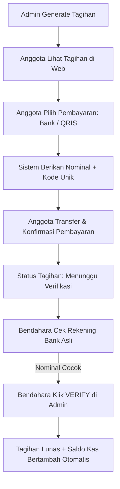

# DOKUMENTASI PRODUK: WargaKas
*Aplikasi Keuangan & Portal Transparansi Mandiri untuk Komunitas dan Organisasi*

---

## 1. Deskripsi & Konsep Produk

**WargaKas** adalah paket aplikasi web pengelolaan keuangan mandiri (*self-hosted*) yang dirancang khusus untuk komunitas, klub olahraga, yayasan, sekolah, dan organisasi non-profit. 

Berbeda dengan sistem SaaS (*Software as a Service*) berlangganan, aplikasi ini dijual sebagai **aplikasi utuh siap pasang (Single-Tenant)**. Organisasi membeli aplikasi ini sekali, memasangnya di hosting mereka sendiri, dan memiliki kontrol penuh atas data mereka tanpa biaya bulanan pihak ketiga.

### Masalah yang Diselesaikan:
1. **Ketidakpercayaan Anggota/Donatur**: Menghilangkan kecurigaan dengan menyediakan **Portal Transparansi Publik** yang menampilkan arus kas secara real-time.
2. **Pembukuan Manual yang Rumit**: Membantu bendahara mengelola tagihan rutin anggota dan pengeluaran kas tanpa perlu menggunakan spreadsheet yang rawan salah input.
3. **Beban Biaya Transaksi**: Menghindari potongan biaya transaksi (*transaction fee*) dari payment gateway pihak ketiga dengan menggunakan **sistem verifikasi transfer manual**.

### Target Konsumen (Bahan Landing Page):
*   **Klub Olahraga & Hobi** (Archery, Menembak, Berkuda, Komunitas Motor, dll.)
*   **Komunitas Keagamaan & Rumah Ibadah** (Pengelola Kas Masjid, Gereja, dll.)
*   **Yayasan Sosial & LSM (NGO)** yang membutuhkan transparansi donasi.
*   **Paguyuban & Pengelola Lingkungan** (Iuran keamanan/kebersihan RT/RW atau Perumahan).

---

## 2. Fitur Utama (Bahan Konten Landing Page)

Aplikasi ini dilengkapi dengan fitur-fitur esensial yang sangat mudah digunakan oleh admin (bendahara) maupun anggota:

### A. Portal Transparansi Publik (Real-Time Transparency Portal)
Halaman depan yang dapat diakses oleh semua anggota atau masyarakat umum tanpa perlu melakukan login.
*   **Manfaat**: Menampilkan pertanggungjawaban keuangan secara visual dan instan.
*   **Detail Tampilan**: Total saldo saat ini, alokasi dana per pos kas, grafik tren pemasukan vs pengeluaran, serta daftar transaksi kas terbaru.

### B. Multi-Kas Terintegrasi (Multi-Fund Ledger)
Memungkinkan bendahara membagi uang kas organisasi ke dalam beberapa kantong dana virtual.
*   **Manfaat**: Uang kas tidak tercampur dan alokasi dana menjadi jelas.
*   **Cara Kerja**: Bendahara dapat membuat sub-kas seperti *Kas Utama*, *Kas Event*, atau *Kas Inventaris*. Setiap transaksi pemasukan dan pengeluaran dicatat sesuai sub-kas tersebut, dan saldo masing-masing kas akan ter-update otomatis.

### C. Pembuat Tagihan Rutin & Kustom (Billing & Invoice Generator)
Pengelolaan tagihan iuran anggota menjadi lebih terorganisir.
*   **Tagihan Rutin**: Bendahara dapat men-generate tagihan kas bulanan untuk seluruh anggota aktif secara massal dalam satu klik.
*   **Tagihan Kustom**: Membuat tagihan satu kali untuk kebutuhan khusus seperti iuran kaos, pendaftaran lomba, atau donasi khusus.
*   **Pelacakan Otomatis**: Sistem otomatis menandai tagihan yang belum dibayar, menunggu verifikasi, atau yang menunggak setelah melewati batas jatuh tempo.

### D. Metode Pembayaran & Verifikasi Manual Aman
Sistem pembayaran yang dirancang untuk kenyamanan anggota namun tetap menjaga biaya operasional organisasi sebesar **Rp 0** (tanpa biaya transaksi pihak ketiga).
*   **Dua Metode Pembayaran**: Menyediakan pilihan metode **Transfer Bank** dan **QRIS Manual** (menampilkan gambar QRIS statis milik organisasi).
*   **Sistem Kode Unik**: Untuk transfer bank, sistem menghasilkan 3 digit kode acak unik di akhir nominal transfer (misal: Rp 50.124). Kode unik ini memudahkan bendahara mencari transaksi yang cocok di mutasi rekening bank mereka.
*   **Konfirmasi & Verifikasi**: Anggota mentransfer dana lalu mengonfirmasi pembayaran di sistem. Bendahara memeriksa mutasi rekening aslinya, lalu melakukan klik **Verify** di dashboard admin untuk menyelesaikan status tagihan secara manual.

### E. Pencatatan Pengeluaran Kas (Expense Tracker)
Mendokumentasikan setiap rupiah yang keluar dari kas organisasi.
*   **Cara Kerja**: Bendahara mencatat pengeluaran berdasarkan kategori (`PERALATAN`, `KONSUMSI`, `EVENT`, `OPERASIONAL`, `TRANSPORTASI`, `LAINNYA`), memilih pos kas yang dikurangi, dan menambahkan deskripsi singkat.

### F. Papan Informasi & Pengumuman (Announcements Board)
Media informasi resmi untuk menyampaikan pemberitahuan terkait keuangan kepada seluruh anggota.

---

## 3. Alur Kerja Aplikasi (Workflow)

---

## 4. Nilai Jual Produk & Strategi Harga (Untuk Landing Page)

Sebagai produk aplikasi web utuh (*lifetime license*), Anda dapat memposisikan produk ini dengan keunggulan utama: **Sekali Bayar, Gunakan Selamanya!**

### Keunggulan Kompetitif (Selling Points):
1. **Tanpa Biaya Langganan Bulanan**: Pembeli tidak perlu dibebani biaya bulanan seperti aplikasi SaaS pada umumnya.
2. **Tanpa Biaya Transaksi (Potongan Gateway)**: Karena verifikasi dilakukan secara manual oleh bendahara, 100% dana iuran masuk utuh ke rekening organisasi tanpa potongan sepeser pun.
3. **Privasi Data Penuh**: Aplikasi dipasang di server milik pembeli sendiri, sehingga data keuangan organisasi mereka aman dan tidak diintip oleh pihak lain.

### Rekomendasi Paket Harga untuk Landing Page:
*   **Paket Personal / Komunitas Kecil (Lite)**:
    *   Lisensi untuk 1 website organisasi.
    *   Maksimal 50 anggota.
    *   *Harga Rekomendasi*: Rp [Harga Anda] (Sekali bayar).
*   **Paket Organisasi Menengah / Klub Profesional (Pro)**:
    *   Lisensi untuk 1 website organisasi.
    *   Jumlah anggota tidak terbatas.
    *   Bantuan instalasi gratis ke hosting.
    *   *Harga Rekomendasi*: Rp [Harga Anda] (Sekali bayar).
